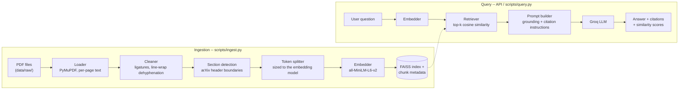

# Papermind

A Retrieval-Augmented Generation (RAG) question-answering system over a collection of AI
research papers. Ask a question in natural language; get an answer grounded in the actual paper
text, with citations back to the source document and page.

This is a portfolio/learning project built incrementally across several sessions, each adding one
capability and evaluating it with real measurements rather than assumptions. The `evaluation/`
directory and session-by-session git history are as much a part of the project as the code.

## Overview

- Ingests PDF research papers, extracts and cleans their text, splits them into retrieval-sized
  chunks, embeds those chunks, and indexes them in FAISS.
- Answers questions by embedding the query, retrieving the most relevant chunks, and asking an
  LLM (via Groq) to answer using only that retrieved context -- with an explicit instruction to
  say so, rather than guess, when the context doesn't contain the answer.
- Exposes the pipeline as a FastAPI service, and ships a reproducible evaluation harness that
  measures retrieval quality, citation correctness, answer groundedness, and latency.

## Features

- PDF ingestion with per-page metadata (source file, page number) preserved through every stage
- Token-aware chunking sized to the embedding model's actual limits, with section-boundary
  detection to avoid mixing two unrelated topics into one chunk (see [Chunking strategy](#chunking-strategy))
- FAISS-backed semantic search with citation and similarity scores returned alongside every answer
- Grounded answer generation with an explicit "say you don't know" instruction, and citations
  built deterministically from retrieved chunks -- never parsed out of the LLM's own text
- FastAPI service with liveness/readiness separated (`/health` never depends on the index being
  loaded), structured error responses, and startup that loads the embedding model and FAISS index
  once, not per-request
- A from-scratch evaluation harness: Hit Rate@k and MRR at document/page/chunk granularity,
  LLM-as-judge groundedness scoring, deterministic citation-correctness checks, and latency
  percentiles -- all reproducible via one script and one JSON eval set
- Docker image and Compose setup for running the service without a local Python environment

## Tech Stack

| Concern | Choice |
|---|---|
| Language | Python 3.12 |
| PDF extraction | PyMuPDF |
| Chunking | LangChain text splitters (token-aware) + a custom section-boundary detector |
| Embeddings | Sentence Transformers (`all-MiniLM-L6-v2`), local, no external API calls |
| Vector search | FAISS (`IndexFlatIP`, exact search) |
| LLM | Groq (`llama-3.3-70b-versatile` by default) |
| API | FastAPI + Pydantic |
| Config | pydantic-settings, entirely environment-variable driven |
| Packaging | Docker (multi-stage), Docker Compose |
| Tests | pytest, 87 tests, no network calls in the unit suite (LLM/embedding calls are mocked) |

Why each of these over the obvious alternatives is explained in the git history of the sessions
that introduced them -- the short version: FAISS and local embeddings avoid a hosted vector-DB
dependency for a corpus this size; Groq for its free tier and low latency; FastAPI for native
Pydantic validation and async support around what's fundamentally an I/O-bound (LLM API call)
request.

## Architecture

Two independent pipelines. Ingestion runs offline, in batch, whenever the paper collection
changes. Querying runs online, per request.



## Repository Layout

```
papermind/
├── src/papermind/
│   ├── ingestion/       # PDF loading (loader.py) + text cleaning (cleaner.py)
│   ├── chunking/        # token splitter (splitter.py) + section detection (sections.py)
│   ├── embeddings/      # Sentence Transformers wrapper
│   ├── vectorstore/     # FAISS index build/load/persist
│   ├── retrieval/       # query -> top-k relevant chunks
│   ├── generation/      # prompt building, Groq client, answer orchestration
│   ├── api/             # FastAPI app, routes, request/response schemas
│   ├── evaluation/      # retrieval metrics, LLM-judge, citation checks
│   └── core/            # settings, logging
├── scripts/             # CLI entry points: ingest.py, query.py, evaluate.py
├── evaluation/          # eval_set.json (input) + report.md/results.json (generated)
├── docker/              # Dockerfile
├── docker-compose.yml
├── tests/unit/          # 87 tests, no network calls
├── data/                # raw/ (source PDFs) and processed/ (chunks.json) -- gitignored
└── vector_store/        # persisted FAISS index -- gitignored
```

`data/` and `vector_store/` are gitignored on purpose: PDFs and derived indexes are large,
regenerable artifacts, not source. Regenerate them with `scripts/ingest.py`.

## Installation

Requires Python 3.11+ (developed against 3.12).

```bash
git clone <this-repo>
cd papermind
python3.12 -m venv .venv
source .venv/bin/activate
pip install -e ".[dev]"
cp .env.example .env   # then set GROQ_API_KEY -- see Configuration below
```

Or, equivalently: `make install`.

## Building the Corpus

Drop PDF research papers into `data/raw/`, then:

```bash
python scripts/ingest.py     # or: make ingest
```

This loads every PDF, cleans and chunks the text, embeds the chunks, and writes a FAISS index to
`vector_store/`. Re-running it rebuilds the index from scratch (idempotent, not incremental).
A single bad or unreadable PDF is logged and skipped, not fatal to the run.

## Running Locally

```bash
uvicorn papermind.api.main:app --reload    # or: make run
```

Swagger UI: `http://127.0.0.1:8000/docs`.

Interactive CLI, if you'd rather not use the API:

```bash
python scripts/query.py                     # interactive
python scripts/query.py "What is LoRA?"      # single question
```

## Running with Docker

```bash
cp .env.example .env    # set GROQ_API_KEY first
docker compose up -d
curl http://localhost:8000/health
```

`docker-compose.yml` bind-mounts `./vector_store` and `./data` into the container, so an index
you've already built locally is used as-is -- nothing is copied into the image itself (see
`.dockerignore`). If no index exists yet, the API still starts cleanly; see
[Startup behavior](#startup-behavior-with-and-without-an-index) below.

To rebuild the index from inside the container instead of locally:

```bash
docker compose exec api python scripts/ingest.py
```

**Live-reloading dev variant** (bind-mounts `./src`, editable install, `uvicorn --reload`):

```bash
docker compose --profile dev up api-dev    # or: make docker-dev
```

**Build without Compose:**

```bash
docker build -f docker/Dockerfile --target runtime -t papermind:latest .
docker run -d -p 8000:8000 --env-file .env \
  -v "$(pwd)/vector_store:/app/vector_store" \
  papermind:latest
```

### Startup behavior with and without an index

- **Index exists:** loaded at startup; `/query` becomes available once loading finishes.
- **No index yet:** the app still starts and `/health` still returns 200 (liveness is
  independent of whether the index loaded -- see [Configuration](#configuration)/architecture
  notes). The logs state clearly what to do:

  ```
  ERROR | No FAISS index found at vector_store. Run scripts/ingest.py first; /query will return 503 until then.
  ```

  `/query` returns `503` until ingestion has been run. **Ingestion never runs automatically** --
  this is deliberate, so the container never silently starts re-processing PDFs on every restart.

## Running Evaluation

```bash
python scripts/evaluate.py    # or: make evaluate
```

Runs the retrieval sweep (Hit Rate@k / MRR at document, page, and chunk granularity, k=3/5/8)
against `evaluation/eval_set.json` (54 hand-written questions across 13 indexed papers, each
verified against real chunk content before being written), plus a generation-quality pass
(LLM-as-judge groundedness, citation correctness, latency) at k=5. Writes `evaluation/report.md`
and raw `evaluation/results.json`.

**Results, reported exactly as measured** (see `evaluation/report.md` for full detail and the
investigation behind these numbers -- nothing here is rounded up or cherry-picked):

| k | Doc Hit Rate | Page Hit Rate | Chunk Hit Rate |
|---|---|---|---|
| 3 | 0.98 | 0.53 | 0.00 |
| 5 | 0.98 | 0.63 | 0.00 |
| 8 | 0.98 | 0.78 | 0.11 |

Document-level retrieval is reliable. Page-level retrieval is decent and improves meaningfully
with larger k. Chunk-level Hit Rate (exact-chunk lookup, n=9 narrow factual questions only) is
weak in absolute terms -- investigated in detail in the report rather than papered over; the
root causes traced out were a genuine short-chunk/weak-embedding trade-off in one case and a
pre-existing eval-annotation issue in another, not a single clean explanation.

**Generation-quality metrics (groundedness score, citation accuracy on the full set) do not have
a trustworthy full-sample measurement as of the last run** -- Groq's free-tier daily token quota
was exhausted mid-run more than once during development. Retrieval metrics above are unaffected
(FAISS is local, no API calls). Re-run `scripts/evaluate.py` on a fresh quota day for current
generation-quality numbers before relying on them.

### Chunking strategy

The current default chunker detects arXiv-style section headers (`5.2 Hardware and Schedule`,
`5.3 Optimizer`, etc.) and never lets a single chunk span two sections, on top of the original
token-based splitter. **This was evaluated against the simpler token-only chunker it replaced,
not adopted on assumption:** section-aware chunking measurably improved page-level Hit Rate at
every k tested, and directly fixed a diagnosed failure (a chunk that mixed GPU-schedule and
optimizer-hyperparameter text, diluting its embedding). It did not improve every metric --
chunk-level Hit Rate on the narrow-question subset dropped, for reasons investigated and
documented in `evaluation/report.md` rather than assumed. It's the current default because the
overall evidence favored it, not because the result was uniformly positive.

## API Example

```bash
curl -X POST http://localhost:8000/query \
  -H "Content-Type: application/json" \
  -d '{"question": "What is the core idea behind LoRA?", "k": 5}'
```

```json
{
  "question": "What is the core idea behind LoRA?",
  "answer": "LoRA freezes the pre-trained model weights and injects trainable rank decomposition matrices into each layer of the Transformer architecture [1], greatly reducing the number of trainable parameters needed for downstream tasks...",
  "citations": [
    {"source_file": "lora_low_rank_adaptation.pdf", "page_number": 1}
  ],
  "retrieved_chunks": [
    {"text": "...", "source_file": "lora_low_rank_adaptation.pdf", "page_number": 1, "score": 0.71}
  ]
}
```

`GET /health` returns `{"status": "ok"}` whenever the process is alive, independent of index
state (see [Startup behavior](#startup-behavior-with-and-without-an-index)).

## Configuration

Everything is environment-variable driven (`pydantic-settings`, loaded from `.env` locally or
real environment variables in Docker). See `.env.example` for the full list with defaults:

| Variable | Purpose |
|---|---|
| `GROQ_API_KEY` | required for any generation (not retrieval-only usage) |
| `GROQ_MODEL` | LLM served by Groq |
| `EMBEDDING_MODEL` | Sentence Transformers model name |
| `RAW_PDF_DIR`, `PROCESSED_DIR`, `VECTOR_STORE_DIR` | filesystem paths, overridable for volume mounts |
| `API_HOST`, `API_PORT` | server bind address, used by the Docker entrypoint |
| `LOG_LEVEL` | root logger level (`DEBUG`/`INFO`/`WARNING`/`ERROR`) |

## Testing

```bash
pytest    # or: make test
```

87 tests. No network calls in the unit suite -- Groq and the embedding model are mocked or, where
a real embedding model is used (a few retrieval tests), it's the actual local Sentence
Transformers model with no network dependency once its weights are cached.

## Troubleshooting

**`ModuleNotFoundError: No module named 'papermind'` despite `pip install -e .` succeeding
(macOS only):** macOS occasionally sets the filesystem "hidden" flag on the editable install's
`.pth` file, which Python's `site` module silently skips. This has been observed specifically
when the project directory is inside an iCloud-synced folder (e.g. `~/Desktop` with "Desktop &
Documents" sync enabled) -- iCloud's sync daemon appears to reapply the flag. Check with `ls -lO`
(look for `hidden` in the flags column) and fix with:

```bash
chflags nohidden .venv/lib/python3.12/site-packages/_editable_impl_papermind.pth
```

Pytest is unaffected (`pythonpath = ["src"]` in `pyproject.toml` sidesteps it entirely), and
`scripts/*.py` carry a defensive `sys.path` fallback. The durable fix is moving the project
outside an iCloud-synced directory. The Docker image is entirely unaffected -- it uses a normal,
non-editable install (see `docker/Dockerfile`), so this class of problem cannot occur there.

**Groq `429` / rate limit errors during evaluation:** the free tier has a small daily token
quota shared across the whole project. `scripts/evaluate.py` isolates a failure to the single
question that hit it rather than losing the whole run (see `run_generation_eval`); a partial
report still gets written. Retry on a day with a fresh quota for a complete run.

**Docker build pulling multiple GB / very slow on Linux hosts:** if you modify
`docker/Dockerfile` and see large `nvidia-*` package downloads, PyPI's default Linux `torch`
wheel is the CUDA build. The Dockerfile installs CPU-only torch from PyTorch's own index first
specifically to avoid this -- don't remove that step.

## Known Limitations

- **Chunk-level retrieval precision is weak** on narrow factual lookups (Hit Rate 0.00-0.11 across
  tested k) -- see [Running Evaluation](#running-evaluation) and `evaluation/report.md` for the
  investigated root causes. Not resolved as of this writing.
- **Generation-quality metrics lack a recent full-sample measurement** due to Groq free-tier
  quota exhaustion during evaluation runs -- see the same report.
- **No re-ranking or hybrid (keyword + semantic) search** -- pure vector search only. Whether
  this is worth adding hasn't been evaluated; see Future Work.
- **Embedding model choice (`all-MiniLM-L6-v2`) has never been compared against an alternative**
  -- it was the initial choice and has not been challenged with evidence either way.
- **Single-node FAISS, no horizontal scaling story** -- fine at the current corpus size (13
  papers, ~2,300 chunks), untested beyond it.
- **Cold-start network dependency:** the embedding model downloads from Hugging Face Hub on
  first use if not already cached; the Docker image does not pre-bake it.
- **Colima-specific (local dev only, not the image itself):** on this project's colima-based
  local Docker setup, `docker stop` takes the full 10s grace period before SIGKILL. Verified via
  direct in-container signaling that the application's own shutdown handling is correct and
  instant; the delay traces to colima/lima's host-to-guest SIGTERM delivery on this machine, not
  the image. Worth re-checking on a standard Docker host if it matters for your deployment.

## Future Work

- Re-verify the 9 chunk-level evaluation ground-truth annotations for semantic correctness (one
  was found, during Session 7's investigation, to point at a paper's title block rather than an
  actual explanation -- see `evaluation/report.md`)
- Expand the eval set further and re-run generation-quality metrics on a full, unthrottled Groq
  quota
- Evaluate hybrid (BM25 + vector) retrieval and re-ranking against the current pure-vector
  baseline, using the same Hit Rate/MRR harness already built
- Compare `all-MiniLM-L6-v2` against at least one alternative embedding model on the same eval set
- Raise default top-k (page-level Hit Rate climbs meaningfully from k=3 to k=8 in the current
  data) -- flagged as evidence-supported but not yet applied, to avoid changing retrieval
  behavior outside of a session scoped to evaluate that change
